# Как создать документ и настроить совместный доступ в Яндекс Диске

Инструкция описывает создание текстового документа, предоставление доступа по ссылке и приглашение соавтора с правом редактирования через общую папку.

## Перед началом

Откройте [Яндекс Диск](https://disk.yandex.ru/) в браузере и войдите в аккаунт Яндекса. Для проверки приглашения потребуется помощь соавтора, у которого есть собственный аккаунт Яндекса.

> **Важно:** ссылка с правом редактирования позволяет изменять документ всем, у кого она есть. Не передавайте такую ссылку посторонним.

## 1. Создайте текстовый документ

1. Нажмите **Создать** в левой части Яндекс Диска.
2. Выберите **Текстовый документ**.

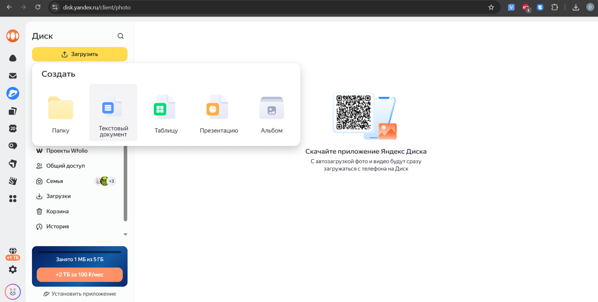

3. Введите название `Текстовый документ для совместной работы`.
4. Нажмите **Создать**.

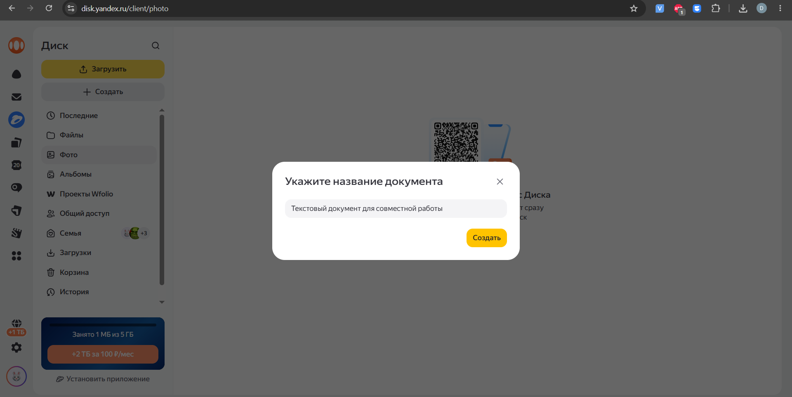

5. Введите в открывшемся редакторе текст `Проверка совместного доступа`.

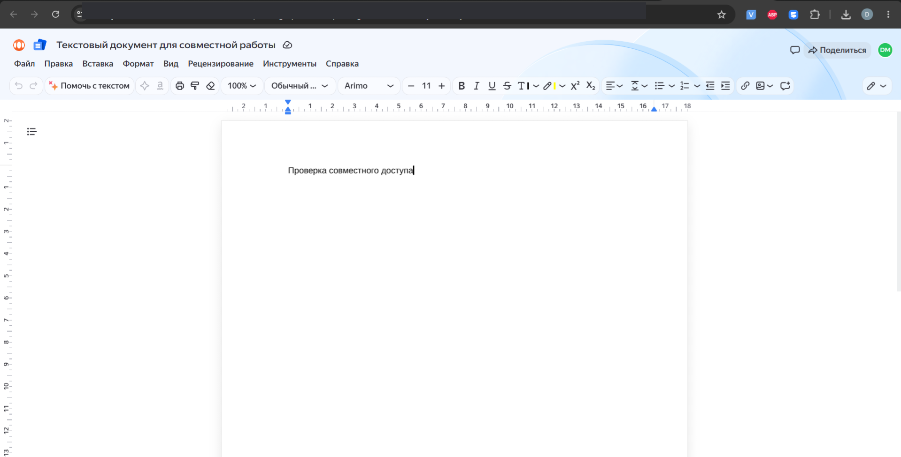

## 2. Настройте доступ к документу по ссылке

1. Нажмите **Поделиться** в правом верхнем углу редактора.
2. Выберите **Редактирование** в окне **Ссылка на файл**.
3. Нажмите **Скопировать ссылку**.

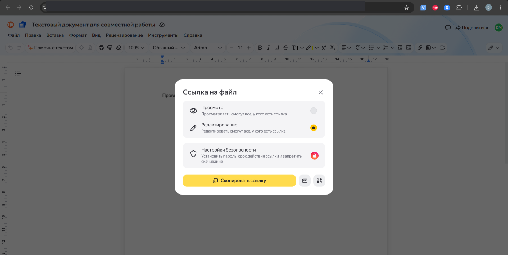

**Результат:** полученная ссылка позволяет редактировать документ всем, у кого она есть.

## 3. Создайте папку для совместной работы

Для приглашения конкретного соавтора используйте общую папку.

1. Вернитесь в раздел **Файлы** Яндекс Диска.
2. Нажмите **Создать**.
3. Выберите **Папку**.

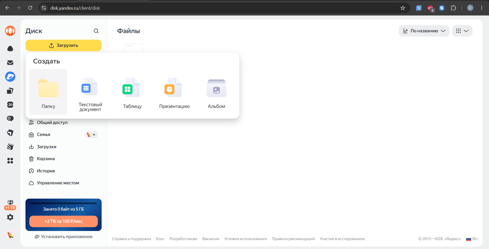

4. Введите название `Совместная работа`.
5. Нажмите **Создать**.

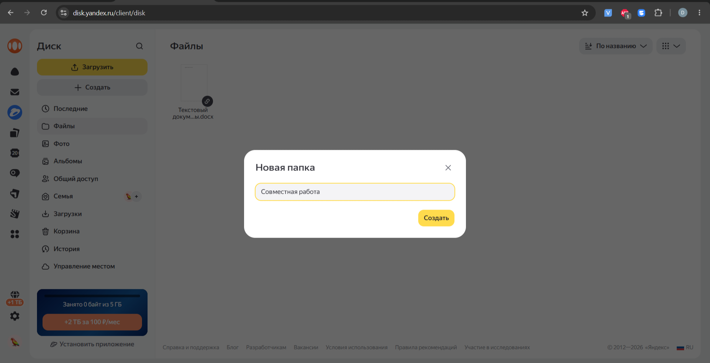

## 4. Переместите документ в папку

1. Откройте раздел **Файлы**.
2. Перетащите документ `Текстовый документ для совместной работы.docx` в папку **Совместная работа**.
3. Нажмите **Переместить** в окне подтверждения.

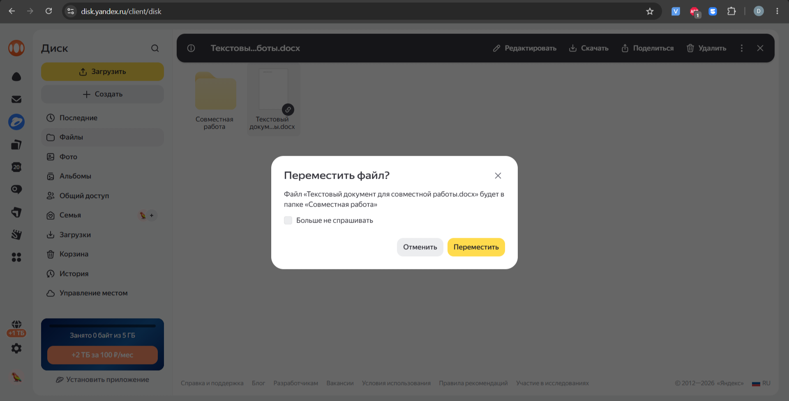

**Результат:** документ находится в папке, к которой можно предоставить доступ конкретному соавтору.

## 5. Пригласите соавтора с правом редактирования

1. Выделите папку **Совместная работа**.
2. Нажмите **Настроить доступ** на верхней панели.

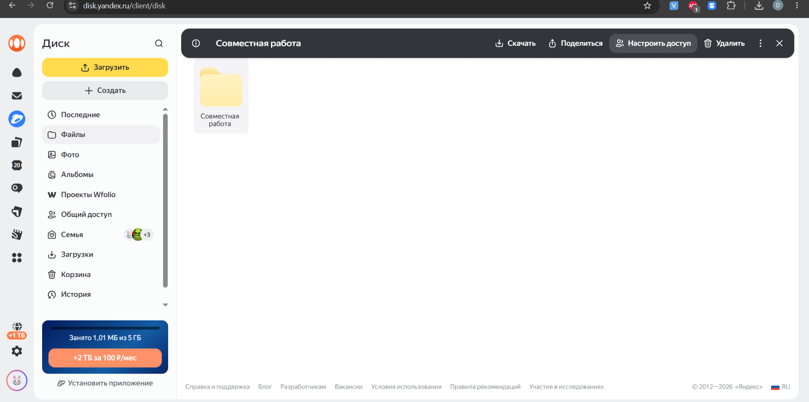

3. Введите адрес электронной почты соавтора в окне **Общий доступ к папке «Совместная работа»**.
4. Выберите **Редактирование**.
5. Нажмите **Пригласить**.

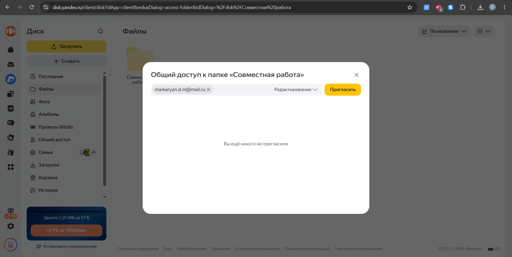

**Результат:** соавтору отправлено приглашение к общей папке.

## 6. Проверьте доступ соавтора

После отправки приглашения попросите соавтора проверить возможность совместной работы с документом.

Для этого соавтору необходимо:

1. Открыть письмо **Яндекс.Диск: доступ к папке «Совместная работа»**, поступившее на указанный адрес электронной почты.
2. Нажать **Принять приглашение**.

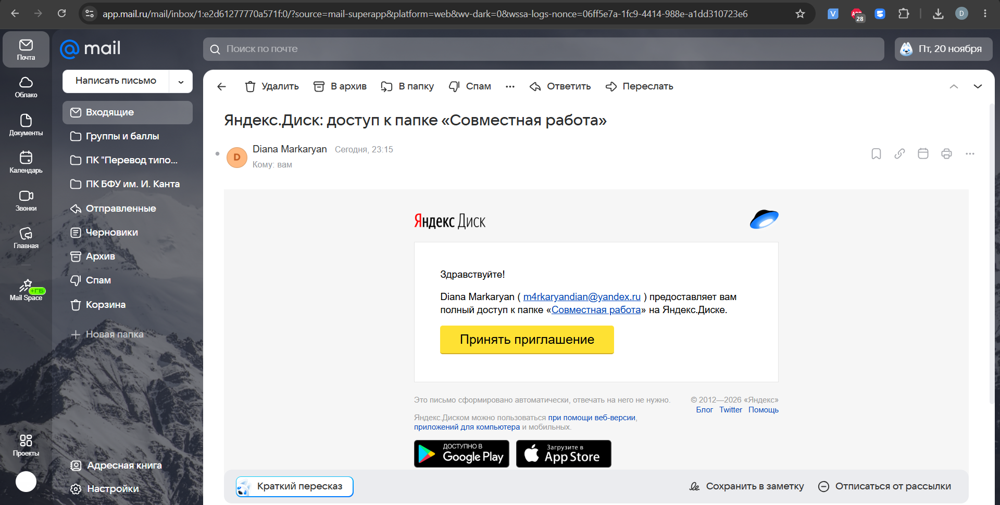

3. При необходимости авторизоваться в своём аккаунте Яндекса.
4. Открыть раздел **Общий доступ** в Яндекс Диске.
5. Принять приглашение к папке **Совместная работа**, если оно ещё ожидает подтверждения.

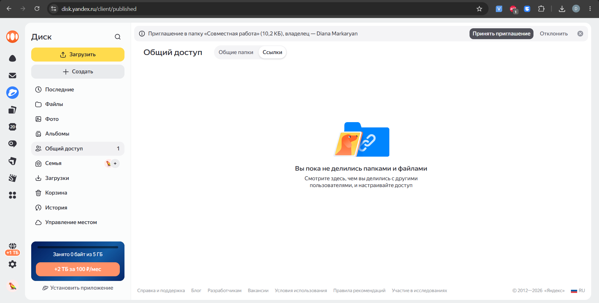

6. Открыть папку **Совместная работа**.
7. Открыть находящийся в ней текстовый документ.
8. Внести тестовое изменение в текст документа, чтобы проверить наличие прав редактирования.

После этого попросите соавтора подтвердить, что документ доступен для редактирования. Откройте документ в своём аккаунте и убедитесь, что внесённое соавтором изменение отображается корректно.

**Результат:** соавтор получил доступ к общей папке и может редактировать документ. Возможность совместной работы успешно проверена.

## Итог

Создан текстовый документ, настроен доступ по ссылке с правом редактирования, документ перемещён в общую папку и отправлено приглашение конкретному соавтору. Приглашённый пользователь проверил доступ из своего аккаунта, а владелец документа убедился в корректном отображении внесённых изменений.
